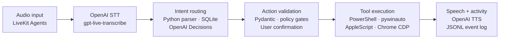

<h1 align="center">Brodi</h1>
<p align="center"><strong>Your bro for getting things done.</strong><br />Say the task. See it happen.</p>

<p align="center">
  
</p>

<p align="center">
  Brodi is a voice assistant that takes action on your computer.<br />
  Open an app, search YouTube, type into Notepad, or run a short routine, just by asking.<br />
  Built for <strong>Windows 11 and macOS</strong>, with OpenAI speech and decision-making.
</p>

<p align="center">
  <em>“Hey bro, open Chrome and go to github.com.”</em><br />
  Brodi runs the steps, shows its progress, and replies: <strong>“Got it.”</strong>
</p>

<p align="center"><a href="#quick-start"><strong>Quick start</strong></a> · <a href="#how-it-works"><strong>How it works</strong></a></p>

## Small tasks should take a small instruction

Opening apps, finding a video, and switching between windows can break your flow. Brodi lets you ask for the result in everyday language and keep going.

- **Acts on your computer.** Uses desktop tools and browser controls to carry out requests.
- **Keeps common tasks simple.** Familiar commands run directly, without a routing-model call.
- **Remembers useful routines.** Eligible successful commands become local shortcuts that can be reused.
- **Handles a few steps together.** Short workflows have time limits, limited retries, and approval checks.
- **Shows its work.** A live activity feed displays your request, current action, and result.
- **English commands, brief replies.** Speech is limited to one or two words: “Got it,” “Search terms?” or “Didn't work.” Full results and confirmation details stay in the activity feed.

Voice recognition still uses OpenAI, including when a command takes a local shortcut.

## What you can say

| Say this | Brodi does this |
| --- | --- |
| “Hey bro, open Chrome.” | Opens Chrome with the configured profile. |
| “Open Notepad.” / “Close Notepad.” | Launches Notepad or requests a normal close, preserving save prompts. |
| “Maximize Notepad.” / “Minimize Chrome.” | Controls the named Windows window directly. |
| “Open Calculator.” / “Open my downloads.” | Opens the app or folder without model routing. |
| “What is 500 x 450?” | Opens Calculator, presses its buttons, and leaves **225,000** visible. Replies “Got it.” |
| “Close calculator.” | Closes the Calculator window Brodi used. |
| “Play Mockingbird by Eminem.” | Opens Spotify Web, selects the track, and checks playback. Signed-in Chrome and browser access required. |
| “Play God's Plan by Drake on Spotify.” | Plays the requested track through the same direct tool. |
| “Open trending page in GitHub.” | Opens [GitHub Trending](https://github.com/trending) directly. |
| “Search YouTube for lofi beats.” | Opens the search results. |
| “Search YouTube.” | Asks what you want to search for. |
| “Type hello world into Notepad.” | Enters the text on Windows and checks it. |
| “Open Chrome and go to github.com.” | Runs a short two-step workflow. |
| “Run presentation workspace.” | Runs the built-in routine to open Chrome and GitHub. |
| “Open my Google Keep and show the top note.” | Uses your signed-in Chrome session; browser access must be set up first. |
| “Remember that my preferred browser is Arc.” | Saves the preference locally. |
| “What do you remember?” | Shows saved facts and the shortcut count. |

Start Brodi and wait for the short rising chime. In foreground mode, **“Hey bro” is optional.** With [sign-in startup enabled](docs/WAKE.md), say **“Hey bro wake up.”** Brodi says **“Yes sir, I'm listening.”** and then plays a ready beep; speak your command after the beep. This works on macOS and Windows. Say **“cancel”** to dismiss a pending question or action.

### Mute during a demo

Press **Ctrl+Space** on Windows or **Control+Space (⌃Space)** on macOS from any app to toggle Brodi's microphone. A short **falling chime means muted**; a **rising chime means listening**. The tray and activity view show the current microphone state and shortcut hint. The Mac shortcut uses Control, not Command.

While muted, Brodi drops incoming microphone audio before transcription and ignores voice commands, including “hey bro” and confirmation answers. Other apps can still use the microphone, and Brodi can finish an already accepted task and play its reply. Unmuting discards partial speech; wait for the rising chime, then start a fresh command. The cues are generated locally and need no speech API call.

If the shortcut is unavailable, Brodi stays muted and explains the problem. Use the tray's microphone control as a fallback. On macOS, check **System Settings → Keyboard → Keyboard Shortcuts → Input Sources** for a conflicting Control+Space binding; on either platform, close another app using the shortcut and restart Brodi. Stopping Brodi releases the shortcut.

App support depends on the platform, installed apps, and permissions. Both platforms have desktop tray controls. Windows uses native UI Automation; macOS uses AppleScript and system permissions.

**Ready for a live demo:** [55 ready-made command examples and the stage runbook](docs/DEMO.md).
Windows checks measured **24 ms** to dispatch GitHub Trending and **101 ms** to repeat
500 × 450 in an already-open Calculator, including display verification. First opening
Calculator took **1.34 seconds**. Spotify includes network and player startup time.
These measurements exclude OpenAI transcription and speech playback. Run
`python -m brodi.demo --catalog` to see the command menu.

## Quick start

You need **Python 3.12+**, **[uv](https://docs.astral.sh/uv/)**, and an **[OpenAI API key](https://platform.openai.com/api-keys)** with access to the configured models. Voice mode also needs an internet connection, microphone, and speaker. Install Chrome for the browser examples.

### 1. Get the project

```bash
git clone https://github.com/OmiChrome/Brodi.git
cd Brodi
uv sync
```

### 2. Add your API key

Create a local settings file:

```powershell
# Windows PowerShell
Copy-Item .env.example .env.local
```

```bash
# macOS
cp .env.example .env.local
```

Open `.env.local` and fill in:

```dotenv
OPENAI_API_KEY=your_key_here
```

One key covers Brodi's OpenAI features. Local console mode does not need a LiveKit cloud account or a local speech-model download.

### 3. Start talking

**Windows**

```powershell
.\brodi.cmd start
```

Double-clicking `brodi.cmd` also starts Brodi. Right-click its tray icon to mute the microphone, start, stop, restart, show activity, or open the log.

```powershell
.\brodi.cmd status --once  # Check the current state
.\brodi.cmd stop           # Stop the assistant
.\brodi.cmd tray           # Open controls without starting the microphone
```

**macOS**

```bash
uv run python agent.py console
```

Allow microphone access and any requested app Automation permissions. Native input may also need Accessibility access. For background controls, run `chmod +x brody`, then use `./brody start`, `./brody status`, and `./brody stop`. Click the menu-bar microphone to mute, restart, or open activity. `./brody tray` opens the controls without starting the microphone.

### Always available with "Hey bro"

Run `.\brodi.cmd wake enable` on Windows or `./brody wake enable` on macOS.
Brodi starts in the background at sign-in; close the terminal and say **"Hey bro, open GitHub."**
The listener requires the wake phrase, allows brief follow-ups, and recovers if the voice process crashes.
**It streams microphone audio to OpenAI while running**, even before the wake phrase.
Use `wake disable` to stop it and remove login startup. It works while signed in and awake.
See [background wake setup and controls](docs/WAKE.md), including macOS microphone permissions.

### Prefer typing?

The text CLI uses the same command engine without recording audio:

```bash
uv run python -m brodi.cli --no-learn "open Chrome"
uv run python -m brodi.cli --dry "open github dot com"
uv run python -m brodi.cli --doctor
uv run python -m brodi.cli --memory list
```

`--dry` previews routing without executing or learning tools; unfamiliar requests may still call a model. `--doctor` checks setup and browser access without recording audio or making model calls.

## How it works



**A Python asyncio state machine coordinates the pipeline.** SQLite shortcuts and the direct command parser handle familiar requests; OpenAI Decisions handles model-based tool selection and argument extraction. Pydantic schemas, policy checks, and confirmation gates validate actions before execution.

**Platform tools carry out the action.** Windows uses PowerShell and pywinauto UI Automation, macOS uses AppleScript, and browser workflows use Chrome DevTools Protocol (CDP) over WebSockets to inspect and operate DOM controls. OpenAI Responses with structured outputs handles planning and optional tool generation. OpenAI TTS speaks the result while the JSONL activity journal records progress.

Short desktop plans default to **five action attempts**, **eight seconds per step**, and a **forty-second execution budget**. Optional tool generation proposes and checks a new tool, then asks for confirmation before its first run.

### Where OpenAI fits

| Role | Current project configuration |
| --- | --- |
| Hear the request | Streaming speech recognition with `gpt-live-transcribe`. |
| Choose actions | Decisions for tool selection, arguments, and checks; configured model: `gpt-6-luna`. |
| Build plans and tools | Responses with structured outputs; configured model: `gpt-6-luna`. |
| Speak back | `gpt-4o-mini-tts` with the `onyx` voice, at `1.25x` speed by default. |

These are the repository's configured defaults. Model access depends on your API account. The Decisions wrapper supports a structured Responses fallback. Voice uses an English-only command pipeline with no conversational LLM; `BRODI_VOICE_MODE=pipeline` is the supported mode.

## Browser access

Opening websites works without extra browser debugging setup. Reading notes or interacting with page controls requires Chrome access.

1. Use a Chrome profile already signed in to the site you want.
2. In supported Chrome builds, open `chrome://inspect/#remote-debugging` and enable **Allow remote debugging for this browser instance**.
3. Allow the connection when Chrome asks.
4. Run `uv run python -m brodi.cli --doctor` to check access.

Brodi discovers the connection or uses `BRODI_CDP_URL`. Set `BRODI_CHROME_PROFILE_EMAIL` or `BRODI_CHROME_PROFILE_DIR` to choose a profile. If page access is unavailable, Brodi explains what is missing.

For song requests, sign in to [Spotify Web](https://open.spotify.com/) in that profile.
Say “play **song title** by **artist** on Spotify.” Brodi matches the title and artist,
presses Play, and checks the player before acknowledging success. Account playback
restrictions, unavailable tracks, ads, and browser dialogs can prevent playback;
see [Spotify's web player help](https://support.spotify.com/us/article/web-player-help/).
The two stage examples have direct track links; other songs use Spotify's search.

## Your control and your data

Brodi is a **hackathon prototype** that can run local scripts and interact with signed-in websites. Keep the default safety policy enabled and try it with non-sensitive tasks first. It checks actions, asks before sensitive changes, and applies the same checks to saved shortcuts.

**Start and Stop control the voice session; Control+Space mutes its input.** While listening, microphone audio is sent to OpenAI for transcription. Muted audio is discarded locally; the microphone device may remain open. Relevant command and app or page context may also be sent for interpretation. Spoken replies are AI-generated. An optional wake phrase does not make listening local.

Facts and shortcuts are stored in an **unencrypted local SQLite database** under `%LOCALAPPDATA%/Brodi` on Windows or `~/Library/Application Support/Brodi` on macOS. Activity and logs can contain commands, results, and page text. Treat them as personal data, and keep keys, local settings, and runtime files out of Git.

## Settings and development

Start with [.env.example](.env.example) or [config.example.yaml](config.example.yaml). Settings take precedence in this order:

**Environment → `.env.local` → `.env` → `brodi.yaml` → defaults**

Restart Brodi after changing settings. The examples cover models, voice, Chrome profiles, memory, workflow limits, and the safety policy.

```bash
uv run pytest -q
uv run ruff check .
uv run ruff format --check .
```

The regular tests use mocked provider and desktop responses, with no paid model calls. Real Chrome fixture tests are optional; see the [implementation guide](docs/IMPLEMENTATION.md).

When contributing, start with an existing command or tool, keep platform and approval checks, and add a focused behavior test. Read the architecture and persona guides before changing execution or spoken replies.

## Explore the project

| Guide | What you will find |
| --- | --- |
| [Hackathon guide](docs/HACKATHON.md) | Pitch, judge walkthrough, and evidence for the demo. |
| [Architecture](docs/ARCHITECTURE.md) | Modules, routing, execution, and trust boundaries. |
| [Implementation](docs/IMPLEMENTATION.md) | Memory, workflows, native input, tests, and validation limits. |
| [Performance](docs/PERFORMANCE.md) | Profiling, measured bottlenecks, and presentation scripts. |
| [Activity](docs/ACTIVITY.md) and [Desktop tray](docs/TRAY.md) | Progress, logs, and assistant controls. |
| [Personas](docs/PERSONAS.md) | Brodi's voice, short replies, and interaction rules. |

[MIT licensed](LICENSE). Built with OpenAI, LiveKit, SQLite, pywinauto, pystray, and native desktop automation.

---

*Made for OpenAI DevDay Exchange Community Hackathon.*
