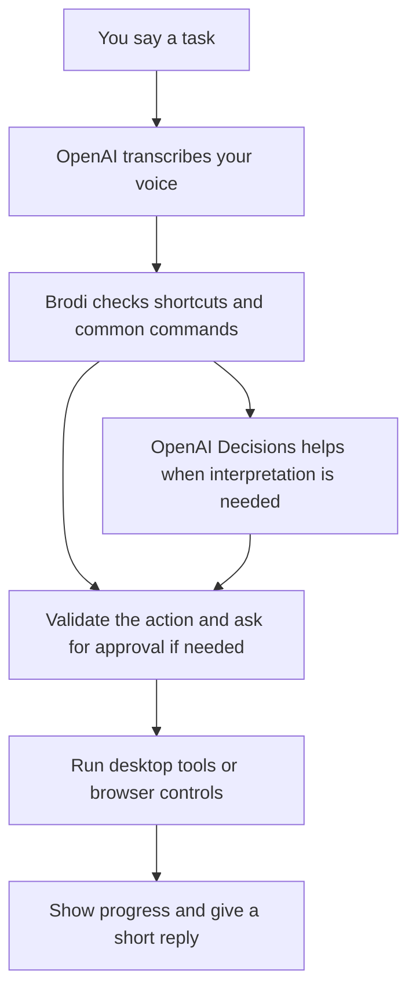

<h1 align="left">Brodi</h1>
<p align="left"><strong>Your bro for getting things done.</strong><br />Say the task. See it happen.</p>

Brodi is a voice assistant that takes action on your computer. Open an app, search YouTube, type into Notepad, or run a short routine, just by asking. Built for **Windows 11 and macOS**, with OpenAI speech and decision-making.

> **“Hey bro, open Chrome and go to github.com.”**
>
> Brodi runs the steps, shows its progress, and replies: **“Got it.”**

**[Quick start](#quick-start)** · **[Demo](#try-the-demo)** · **[How it works](#how-it-works)** · **[Docs](docs/README.md)**

<br clear="right" />

## Small tasks should take a small instruction

Opening apps, finding a video, and switching between windows can break your flow. Brodi lets you ask for the result in everyday language and keep going.

- **Acts on your computer.** Uses desktop tools and browser controls to carry out requests.
- **Keeps common tasks simple.** Familiar commands run directly, without a routing-model call.
- **Remembers useful routines.** Eligible successful commands become local shortcuts that can be reused.
- **Handles a few steps together.** Short workflows have time limits, limited retries, and approval checks.
- **Shows its work.** A live activity feed displays your request, current action, and result.
- **Keeps the conversation short.** “Gotcha.” “On it.” “Got it.” More detail when you ask, or when something needs your input.

Voice recognition still uses OpenAI, including when a command takes a local shortcut.

## What you can say

| Say this | Brodi does this |
| --- | --- |
| “Hey bro, open Chrome.” | Opens Chrome with the configured profile. |
| “Search YouTube for lofi beats.” | Opens the search results. |
| “Search YouTube.” | Asks what you want to search for. |
| “Type hello world into Notepad.” | Enters the text on Windows and checks it. |
| “Open Chrome and go to github.com.” | Runs a short two-step workflow. |
| “Run presentation workspace.” | Runs the built-in routine to open Chrome and GitHub. |
| “Open my Google Keep and show the top note.” | Uses your signed-in Chrome session; browser access must be set up first. |
| “Remember that my preferred browser is Arc.” | Saves the preference locally. |
| “What do you remember?” | Shows saved facts and the shortcut count. |

Start Brodi and wait for **“Listening with OpenAI.”** Then speak. **“Hey bro” is optional.** Say **“cancel”** to dismiss a pending question or action.

App support depends on the platform, installed apps, and permissions. Windows has tray controls and native UI Automation; macOS uses AppleScript and system permissions.

## Quick start

You need **Python 3.12+**, **[uv](https://docs.astral.sh/uv/)**, and an **[OpenAI API key](https://platform.openai.com/api-keys)** with access to the configured models. Voice mode also needs an internet connection, microphone, and speaker. Install Chrome for the browser examples.

### 1. Get the project

```bash
git clone https://github.com/OmiChrome/Brodi.git
cd Brodi
uv sync
```

### 2. Add your API key

Create a local settings file:

```powershell
# Windows PowerShell
Copy-Item .env.example .env.local
```

```bash
# macOS
cp .env.example .env.local
```

Open `.env.local` and fill in:

```dotenv
OPENAI_API_KEY=your_key_here
```

One key covers Brodi's OpenAI features. Local console mode does not need a LiveKit cloud account or a local speech-model download.

### 3. Start talking

**Windows**

```powershell
.\brodi.cmd start
```

Double-clicking `brodi.cmd` also starts Brodi. Right-click its tray icon to start, stop, restart, show activity, or open the log.

```powershell
.\brodi.cmd status --once  # Check the current state
.\brodi.cmd stop           # Stop the assistant
.\brodi.cmd tray           # Open controls without starting the microphone
```

**macOS**

```bash
uv run python agent.py console
```

Allow microphone access and any requested app Automation permissions. Native input may also need Accessibility access. For background controls, run `chmod +x brody`, then use `./brody start`, `./brody status`, and `./brody stop`.

### Prefer typing?

The text CLI uses the same command engine without recording audio:

```bash
uv run python -m brodi.cli --no-learn "open Chrome"
uv run python -m brodi.cli --dry "open github dot com"
uv run python -m brodi.cli --doctor
uv run python -m brodi.cli --memory list
```

`--dry` previews routing without executing or learning tools; unfamiliar requests may still call a model. `--doctor` checks setup and browser access without recording audio or making model calls.

## Try the demo

Keep the activity view next to Chrome and a clean Notepad window.

1. Say **“Hey bro, open Notepad.”** Show the app opening on Windows.
2. Say **“Type hello world into Notepad.”** Show the entered text.
3. Say **“Search YouTube,”** then answer **“lofi beats.”** Show the follow-up becoming a search.
4. Say **“Run presentation workspace.”** Watch Chrome and GitHub open through a short plan.
5. Repeat the workspace request to demonstrate a saved shortcut, then stop the assistant from the tray.

The repository also includes **six scripted demo scenarios** and a profiler:

```powershell
.\scripts\demo.ps1                 # Rehearse without opening apps or calling APIs
.\scripts\demo.ps1 -Run -Repeat 2  # Run the demo with real apps and tabs
.\scripts\profile.ps1              # Measure local routing and execution stages
```

Portable equivalents: `uv run python -m brodi.demo` and `uv run python -m brodi.performance`. Demo runs use temporary memory and leave your saved shortcuts alone.

See the [hackathon pitch and walkthrough](docs/HACKATHON.md) and [profiling guide](docs/PERFORMANCE.md) for presentation notes, reports, and measurement limits. Reported dispatch timings exclude speech recognition, page loading, and spoken playback.

## How it works



**The key idea: let code handle familiar actions and use AI where interpretation helps.** Brodi uses PowerShell and Windows UI Automation on Windows, AppleScript on macOS, and Chrome's page controls for browser tasks.

Short desktop plans default to **five action attempts**, **eight seconds per step**, and a **forty-second execution budget**. Optional tool generation proposes and checks a new tool, then asks for confirmation before its first run.

### Where OpenAI fits

| Role | Current project configuration |
| --- | --- |
| Hear the request | Streaming speech recognition with `gpt-live-transcribe`. |
| Choose actions | Decisions for tool selection, arguments, and checks; configured model: `gpt-6-luna`. |
| Build plans and tools | Responses with structured outputs; configured model: `gpt-6-luna`. |
| Speak back | `gpt-4o-mini-tts` with the `onyx` voice, at `1.25x` speed by default. |

These are the repository's configured defaults. Model access depends on your API account. The Decisions wrapper supports a structured Responses fallback, and `BRODI_VOICE_MODE=realtime` selects the alternative voice backend.

## Browser access

Opening websites works without extra browser debugging setup. Reading notes or interacting with page controls requires Chrome access.

1. Use a Chrome profile already signed in to the site you want.
2. In supported Chrome builds, open `chrome://inspect/#remote-debugging` and enable **Allow remote debugging for this browser instance**.
3. Allow the connection when Chrome asks.
4. Run `uv run python -m brodi.cli --doctor` to check access.

Brodi discovers the connection or uses `BRODI_CDP_URL`. Set `BRODI_CHROME_PROFILE_EMAIL` or `BRODI_CHROME_PROFILE_DIR` to choose a profile. If page access is unavailable, Brodi explains what is missing.

## Your control and your data

Brodi is a **hackathon prototype** that can run local scripts and interact with signed-in websites. Keep the default safety policy enabled and try it with non-sensitive tasks first. It checks actions, asks before sensitive changes, and applies the same checks to saved shortcuts.

**Start and Stop control the voice session.** While it is active, microphone audio is sent to OpenAI for transcription. Relevant command and app or page context may also be sent for interpretation. Spoken replies are AI-generated. An optional wake phrase does not make listening local.

Facts and shortcuts are stored in an **unencrypted local SQLite database** under `%LOCALAPPDATA%/Brodi` on Windows or `~/Library/Application Support/Brodi` on macOS. Activity and logs can contain commands, results, and page text. Treat them as personal data, and keep keys, local settings, and runtime files out of Git.

## Settings and development

Start with [.env.example](.env.example) or [config.example.yaml](config.example.yaml). Settings take precedence in this order:

**Environment → `.env.local` → `.env` → `brodi.yaml` → defaults**

Restart Brodi after changing settings. The examples cover models, voice, Chrome profiles, memory, workflow limits, and the safety policy.

```bash
uv run pytest -q
uv run ruff check .
uv run ruff format --check .
```

The regular tests use mocked provider and desktop responses, with no paid model calls. Real Chrome fixture tests are optional; see the [implementation guide](docs/IMPLEMENTATION.md).

When contributing, start with an existing command or tool, keep platform and approval checks, and add a focused behavior test. Read the architecture and persona guides before changing execution or spoken replies.

## Explore the project

| Guide | What you will find |
| --- | --- |
| [Hackathon guide](docs/HACKATHON.md) | Pitch, judge walkthrough, and evidence for the demo. |
| [Architecture](docs/ARCHITECTURE.md) | Modules, routing, execution, and trust boundaries. |
| [Implementation](docs/IMPLEMENTATION.md) | Memory, workflows, native input, tests, and validation limits. |
| [Performance](docs/PERFORMANCE.md) | Profiling, measured bottlenecks, and presentation scripts. |
| [Activity](docs/ACTIVITY.md) and [Windows tray](docs/TRAY.md) | Progress, logs, and assistant controls. |
| [Personas](docs/PERSONAS.md) | Brodi's voice, short replies, and interaction rules. |

[MIT licensed](LICENSE). Built with OpenAI, LiveKit, SQLite, pywinauto, pystray, and native desktop automation.

---

*Made for OpenAI DevDay Exchange Community Hackathon.*
