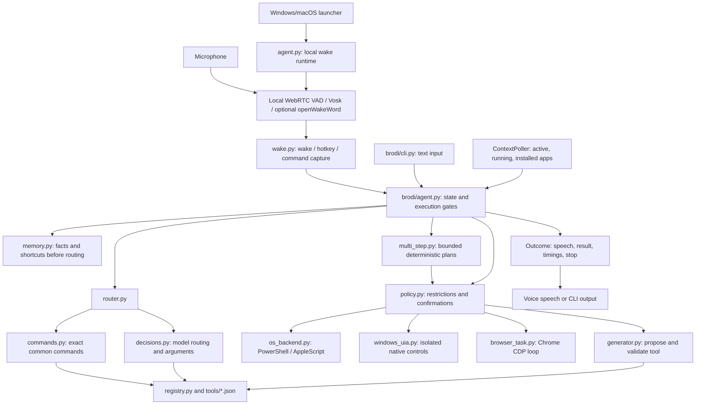

# Brodi architecture

## Scope

Brodi is a Python desktop voice agent for macOS and Windows 11. It accepts short
requests, routes them to existing tools where possible, and executes operating-system
scripts or a Chrome browser task. Unknown actions can enter an optional tool-generation
flow. A text CLI exercises the same agent without audio.

This document describes the checked-in code, not a guarantee that every tool works
with every installed app or website. Names such as `DynamicMacAgent`, `MacContext`,
`run_applescript`, and `JevRouter` remain for compatibility even where the implementation
is cross-platform or uses OpenAI Decisions.

The intended spoken personality is defined in [PERSONAS.md](PERSONAS.md). It is separate
from the runtime control flow documented here.

The [implementation guide](IMPLEMENTATION.md) details the offline wake runtime, isolated
Windows UIA helper, SQLite facts/shortcuts, bounded desktop plans, new settings, and live
smoke-test evidence. These features preserve the Decisions and deterministic execution path.

## System map



The voice session owns audio and conversation. The core agent owns action selection,
pending questions, confirmations, execution, and recent task memory. Model output is
used within those workflows; it does not replace the state machine.

## Repository map

Paths in this table are relative to the repository root.

| Path | Responsibility |
| --- | --- |
| [`agent.py`](../agent.py) | Default local wake console; optional legacy LiveKit voice session and worker entrypoints. |
| [`brodi/__init__.py`](../brodi/__init__.py) | Lazy public export of `DynamicMacAgent`; avoids importing runtime defaults before configuration. |
| [`brodi/config.py`](../brodi/config.py) | Load env files then optional YAML, preserve existing environment, parse boolean flags. |
| [`brodi/models.py`](../brodi/models.py) | Luna defaults and stable system/schema prompt-cache keys. |
| [`brodi/paths.py`](../brodi/paths.py) | Platform user-data locations and optional override. |
| [`brodi/wake.py`](../brodi/wake.py) | Offline listener, wake/hotkey lifecycle, capture window, counters, and model installer. |
| [`brodi/wake_runtime.py`](../brodi/wake_runtime.py) | Default local microphone session, queue, interruptible reply playback, core integration, shutdown. |
| [`brodi/voice.py`](../brodi/voice.py) | Legacy LiveKit transcript `VoiceGate` and activation window. |
| [`brodi/memory.py`](../brodi/memory.py) | Versioned SQLite facts and tool-only shortcuts, retention, matching, confirmed deletion/overwrite. |
| [`brodi/multi_step.py`](../brodi/multi_step.py) | Typed plans, strict planner schema, attempt/deadline limits, retry/recovery, lightweight observation. |
| [`brodi/windows_uia.py`](../brodi/windows_uia.py) | Isolated, bounded pywinauto UIA input, focus, window state, buttons, target policy and readback. |
| [`brodi/native_launch.py`](../brodi/native_launch.py) | Trusted Windows seed launches without a PowerShell startup; unsupported targets retain script execution. |
| [`brodi/smoke.py`](../brodi/smoke.py) | Explicit live Notepad/Chrome probes, offline WAV replay, and dispatch timing. |
| [`brodi/activity.py`](../brodi/activity.py) | Local structured activity journal and live human-readable terminal viewer. |
| [`brodi/tray.py`](../brodi/tray.py) | Windows tray UI, checkout-scoped start/stop/restart controls, live activity status, and single-instance guard; see [TRAY.md](TRAY.md). |
| [`assets/branding/`](../assets/branding/) | Official logo PNG and multi-resolution Windows ICO. |
| [`brodi/commands.py`](../brodi/commands.py) | Wake-prefix normalization, common command parsing, site aliases, homepage/search URL construction. |
| [`brodi/agent.py`](../brodi/agent.py) | Core state machine, execution gates, clarifications, task memory, browser verification, learning orchestration. |
| [`brodi/router.py`](../brodi/router.py) | Direct route when recognized; otherwise batched intent/enum decisions and a separate text-span selection pass. |
| [`brodi/decisions.py`](../brodi/decisions.py) | Typed questions/answers, endpoint adaptation, structured fallback, usage accounting. |
| [`brodi/registry.py`](../brodi/registry.py) | Tool/argument data models, availability, rendering, risk inference, learned-tool persistence. |
| [`brodi/policy.py`](../brodi/policy.py) | Script, app, path, shell, and browser-goal restrictions; browser confirmation terms. |
| [`brodi/os_backend.py`](../brodi/os_backend.py) | Script execution, syntax checks, escaping, app discovery, and foreground-app context. |
| [`brodi/applescript.py`](../brodi/applescript.py) | Compatibility facade plus `MacContext` and `ContextPoller`. |
| [`brodi/chrome.py`](../brodi/chrome.py) | Chrome executable discovery, profile selection, profile cache, launch arguments, template variables. |
| [`brodi/browser_task.py`](../brodi/browser_task.py) | Goal composition, CDP transport, DOM observation, browser decisions/input, budgets, and results. |
| [`brodi/resolvers.py`](../brodi/resolvers.py) | Python-side computed arguments; currently the first YouTube video URL resolver. |
| [`brodi/generator.py`](../brodi/generator.py) | Structured tool generation, validation/retry, predicted-effect review, deduplication, registration. |
| [`brodi/diagnostics.py`](../brodi/diagnostics.py) | Key-presence, Chrome, browser-access, and policy checks without a model call or note reading. |
| [`brodi/cli.py`](../brodi/cli.py) | Interactive/one-shot text commands, route-only mode, policy listing, diagnostics. |
| [`tools/seed.json`](../tools/seed.json) | Checked-in tool catalog and platform-specific scripts. |
| `tools/learned.json` | Runtime-generated tool catalog; ignored by Git. |
| [`brodi.cmd`](../brodi.cmd) | Windows forwarding command for `console.ps1`. |
| [`console.ps1`](../console.ps1) | Windows start/stop/restart/status/log/debug/doctor; live activity by default, snapshots with `--once`. |
| [`console.sh`](../console.sh) | macOS background start/stop and activity status/log/debug wrapper. |
| [`pyproject.toml`](../pyproject.toml) | Python requirement, dependencies, pytest settings, Ruff settings. |
| [`uv.lock`](../uv.lock) | Locked dependency resolution. |
| [`.env.example`](../.env.example) | Example settings without a real key. |
| [`.gitignore`](../.gitignore) | Excludes local secrets, learned tools, environments, and generated caches. |
| [`tests/`](../tests/) | Offline unit/workflow tests and opt-in real Chrome tests. |
| [`docs/`](README.md) | Architecture and persona guidance. |
| [`README.md`](../README.md), [`LICENSE`](../LICENSE) | Getting started and MIT licensing. |

## Startup and configuration

Python 3.12 or newer is required by the project. Runtime dependencies are LiveKit Agents
with its OpenAI plugin, the OpenAI SDK, Pydantic, psutil, python-dotenv, websockets,
sounddevice, Vosk, WebRTC VAD, pynput, PyYAML, and Windows-only pywinauto.
Development dependencies add pytest, pytest-asyncio, and Ruff.

`load_environment()` resolves the repository root from its own file, then loads
`.env.local` followed by `.env`, then optional `brodi.yaml` (or `BRODI_CONFIG`). None
overwrites an existing environment variable. YAML supplies scalar `BRODI_*` keys.
The voice and text entrypoints load configuration before importing Brodi modules that
capture model/profile/policy defaults. When embedding Brodi in another Python program,
load configuration before importing the runtime modules yourself. Restart a running
process after changing defaults captured at import time.

Local console mode uses the local microphone and speakers; it does not require a
LiveKit cloud account. The `agent.py dev` worker mode is a separate deployment path
using LiveKit connection settings. An OpenAI key is required for the configured voice
and model services. Direct command routing avoids a routing-model request but does
not make the voice app an offline assistant.

### Default local voice session

`agent.py console` selects `wake_runtime.py` unless `BRODI_LOCAL_WAKE=false`.
The microphone stays local while idle. WebRTC VAD plus Vosk offline keyword spotting
detects “hey bro” / “yo bro”; an optional custom openWakeWord ONNX engine can trigger
the same capture window. The stripped remainder enters the unchanged core. Hotkey
activation uses Ctrl+Alt+B by default. Wake detection interrupts TTS. Reply generation
and TTS make cloud requests only when a reply is needed. See [IMPLEMENTATION.md](IMPLEMENTATION.md)
for asset setup, counters, limitations, and the verified idle-network behavior.

### Legacy LiveKit voice session

With local wake disabled, the pipeline configures OpenAI STT, a brief conversational LLM, and TTS.
Turn endpointing and interruptions use the session's VAD path. Preemptive generation
is disabled so the user-turn hook can route commands before conversational generation.

Realtime mode instead configures the OpenAI Realtime model, semantic turn detection,
and input transcription. Server-generated automatic responses are disabled; the
same core agent still handles the completed user turn.

`BrodiAgent.on_user_turn_completed()` checks activation, calls the core agent, then:

- Returns normally for `handoff_to_llm`, allowing a conversational reply.
- Speaks `Outcome.speak` directly for action responses and suppresses normal generation.
- Speaks the shutdown response and requests job shutdown for `Outcome.stop`.

### Legacy transcript activation

`VoiceGate` accepts a recognized wake phrase or an utterance within its active window.
The default window is 20 seconds. It is refreshed after the core finishes handling an
accepted turn, including a longer task. A valid pending question/confirmation can
permit an answer outside that window. Blank transcripts are ignored.

In this explicit compatibility mode, audio can still be transcribed by OpenAI
while Brodi waits for a wake phrase. The default local runtime described above avoids that.
The text CLI calls the core directly and does not require voice activation.

## Request routing

### Direct path

`commands.normalize()` trims and normalizes speech, strips a recognized leading wake
phrase, handles polite prefixes/suffixes, and recognizes the `serach` spelling.
`parse_command()` handles common app opens, known-site navigation, URL opens, searches,
and Keep top-note requests. A bare search produces a missing-query question.

For example, `Hey bro, open Chrome` resolves to `open_app(app="Google Chrome")`;
`go to YouTube` resolves to `chrome_open(site="youtube", query="")`. An empty query
for a known site resolves to its homepage, not an empty search page.

`JevRouter.route()` uses a direct command only when its referenced tool is available.
Pending confirmations bypass this direct route so the approval workflow remains in
control. Before normal routing, SQLite shortcuts can resolve exact commands and the
deterministic plan splitter handles compounds such as “open Chrome and go to github.com.”
Other multi-step requests are flagged within the existing Decisions batch and sent to
a bounded Luna planner. Keep note requests explicitly select the browser runner.

### Model path

The router offers tools allowed by policy and application scope, plus chat, stop, and
new-action options. A batched Decisions evaluation chooses the intent and speculative
enum arguments. Only the winning tool's enum answers are consumed. Text arguments
use a second decision over candidate spans copied from the utterance, rather than
free-form argument generation.

The same routing evaluation can include confirmation/denial, browser follow-up,
goal completeness, missing details, and forbidden browser-goal judgments.

`DecisionsClient` uses an available Decisions endpoint. If that interface is absent
or a supported unavailability error occurs, it falls back to a dynamic structured
`responses.parse` schema. Single-option choices can be resolved locally. The fallback
represents choices with confidence `1.0` and predicates as `0.0`/`1.0`; these are not
the same calibrated probabilities as the native endpoint.

## Core state and lifetimes

`DynamicMacAgent.handle()` serializes turns with an async lock. Its error boundary
clears pending work after an unexpected exception and returns a retry message.

| Data/state | Purpose | Lifetime |
| --- | --- | --- |
| `State.IDLE` | Normal routing. | Until an action is staged. |
| `State.AWAITING_CONFIRM` / `Pending` | Holds the selected tool, arguments, staging time, and optional original goal. | 60 seconds for approval validity; a fresh unrelated turn drops the pending action. |
| `pending_question` | Holds a route with a missing argument. | Answers accepted within 60 seconds; cancellation/new commands replace it. |
| `last_browser` | Goal, page, target ID, status, site, clarification history. | Recent-task context for 15 minutes. |
| `last_args` | Prior successful arguments per tool for resolving pronouns. | Current agent process. |
| `ContextPoller` | Active/running apps and installed-app names. | Active/running refresh every second; installed names every 60 seconds. |
| Chrome profile cache | Selected profile directory. | 60-second cache unless explicitly overridden. |
| Learned tool JSON | Reusable generated tool definitions. | Persisted across restarts. |

Browser missing-detail questions are stored in `last_browser` with `status="needs_info"`.
The next follow-up can merge into the original goal; repeat questions are bounded.
SQLite stores explicitly stated facts and successful eligible tool sequences across
restarts. It is not a conversation transcript archive. Shortcut hits precede Decisions
and still revalidate every tool/argument/policy gate. Overwrites and deletes require
confirmation. Facts, shortcuts, retention behavior, and CLI inspection are documented
in [IMPLEMENTATION.md](IMPLEMENTATION.md).

### Decision thresholds

These are current code constants, not user-facing promises about model accuracy.

| Decision | Current threshold |
| --- | --- |
| Tool confidence below which the route is uncertain | `0.45` |
| Hesitant new-action route considered for an existing tool | New-action confidence below `0.6`, candidate probability at least `0.2`. |
| Missing/weak argument | Confidence below `0.35`. |
| Confirmation or denial | At least `0.6`; confirmation must also beat denial. |
| Recent browser follow-up | At least `0.5`. |
| Incomplete browser goal | Completeness below `0.4`, with a named missing detail. |
| Forbidden browser goal | Probability at least `0.6`. |
| Browser success verification | At least `0.5` when verification returns a value. |
| Generated-tool review rejection | Below `0.4` by default; configurable. |

## Tools and OS execution

`ToolRegistry` loads seed definitions and then learned definitions. A `Tool` contains
a description, scope, argument specifications, scripts, runner, speech mode, risk
flag, optional computed arguments, and metadata. The current seed file has 36 entries;
an entry's presence is not proof it is allowed or supported on the current machine.

The catalog includes app launch/quit, volume, notifications, screenshots, appearance,
folders, notes, Chrome/Safari tabs, YouTube playback, music controls, and a generic
web task. Terminal execution and trash emptying also have seed definitions, but the
strict policy blocks them. Music and app-specific operations depend on the relevant
installed app, scope, platform script, and operating-system permissions.

Argument types are `enum` and `text`. Dynamic enums can be populated from running,
installed, or merged application lists. Tools with an application scope are offered
only when that scope is running. `scope_win` can override the Windows scope.

`Tool.render()` substitutes escaped arguments, Chrome profile/home variables, the
computed browser URL, and computed arguments. Windows selects `script_win` when it
exists; otherwise the AppleScript field is retained. That fallback does not translate
an AppleScript tool into a Windows implementation.

Before OS execution, computed arguments are resolved and the rendered script is
checked against policy using the active platform scope. The OS backend returns a
`ScriptResult(ok, output, error)`. Successful arguments become pronoun context.

Windows scripts run through PowerShell with terminating-error behavior and captured
temporary-file output; temporary files avoid inherited GUI-process pipes keeping
the call open. macOS uses `osascript`. The default execution timeout is 20 seconds.
Syntax validation uses the PowerShell AST parser or `osacompile` without running the
proposed action.

The `applescript.py` names are a facade over this backend. psutil and Windows APIs
provide Windows process/window context; macOS context comes from System Events and
application-directory scans.

The YouTube computed resolver fetches search HTML and extracts a first video ID.
It has bounded network/async lookup timeouts and spoken-friendly errors. It is
separate from a plain YouTube search and depends on YouTube's returned page format.

### Tool speech

`speak="done"` produces a generic success acknowledgment. `speak="result"` reads the
script output; other values are templates with `{result}`. Tool scripts can therefore
affect spoken copy as well as behavior. See [PERSONAS.md](PERSONAS.md) before changing
these strings.

## Chrome browser tasks

Opening a homepage/search URL uses an OS tool and does not require CDP. Interacting
with a page requires Chrome remote-debugging access and, for personal sites, the
correct already signed-in profile.

`chrome.py` chooses an explicit profile directory first, then an email-matched profile,
then Chrome's last-used profile, with `Default` as the fallback. Profile metadata is
read from Chrome's Local State file. Browser context resolution may briefly open an
`example.com` probe tab in that profile and close it after discovering its context.
If context matching fails, the code can fall back to the default browser context;
profile pinning is therefore best-effort rather than a strict account boundary.

The CDP connection prefers an explicit endpoint. Without one, it tries Chrome's
`DevToolsActivePort` discovery file, then the default `http://127.0.0.1:9222` endpoint.
Connections use bounded opening and response waits. `access_error()` checks the
connection before browser goal composition. If access is missing for a Keep request,
the agent tries opening the Keep homepage and reports that note interaction remains
unavailable. It does not mark the complete note task executed.

### Browser loop

1. Compose the spoken request into an objective, visible success criterion, and optional
   search query. On composition failure, fall back to the original utterance.
2. Choose a site/search URL or reuse the previous target. A closed target gets a
   replacement rather than an indefinite blank-page wait.
3. Attach over CDP, set the viewport, navigate when needed, and wait briefly for loading.
4. Observe the DOM as page text plus visible interactive controls. Labels include
   accessible names and associated form labels. Disabled controls are omitted.
5. Ask Decisions for one operation and an observed target. Operations are click, fill,
   scroll up/down, wait, done, or blocked. Unknown operations are rejected.
6. For fill, obtain the exact field value from the goal. Recheck the target after that
   model call, then send browser input. A changed/covered target causes re-observation
   within the step budget instead of blindly clicking stale coordinates.
7. Stop on completion, blockage, exception, or budget exhaustion; return `BrowserResult`.
8. When there is a success criterion, the core performs an independent model judgment
   of the final page. A low result can trigger one more browser round, then an honest
   incomplete result.

Observation includes up to 4,000 characters of page text; decision inputs are also
bounded. This is a DOM-driven browser agent, not a screenshot/vision desktop agent.
Targets must refer to observed controls. Canvas-only interfaces, unusual widgets,
and information outside the observed content can still be unsupported.

Blocking browser work runs in a worker thread. Its async Decisions client uses one
event loop for a complete browser run and is closed on that loop. CDP sessions and
owned connections are cleaned up when the run ends.

The default browser budget is 90 seconds and 25 steps. These are loop limits, not a
hard deadline around every provider request. A remote call may add latency beyond a
budget check. Progress callbacks currently begin after 12 seconds of browser work.

## Unknown-action learning

When a request needs a new action and learning is enabled:

1. Build a structured code-generation request with the current platform and context.
2. Parse a `GeneratedTool` proposal or an explanation that the action is infeasible.
3. Render placeholder arguments and reject policy violations.
4. Check syntax without execution and reject scripts without a recognized effect.
5. Ask Decisions whether the script is likely to perform the request. Low review
   confidence causes a retry; a failed/unavailable review can be skipped.
6. Check for duplication with an existing available tool.
7. Register an accepted new definition in `tools/learned.json`.
8. Route its arguments and stage the freshly generated action for user confirmation.

The default is three generation attempts. Review and compilation are predictions and
syntax checks, not proof of runtime success. The learned definition is persisted
before the first confirmation; there is no durable first-run-approval record. The
fresh-generation confirmation and later risk-based execution gates should not be
described as an OS sandbox.

## Policy and trust boundaries

The policy is enabled unless `BRODI_POLICY=off`. It checks tool availability, generated
proposals/registration, and rendered scripts immediately before OS execution. It
restricts system/config paths, sensitive apps, destructive commands, shell operations,
privilege escalation, and other machine-setup actions. Windows adds its own patterns.

Browser restrictions combine hard goal terms, router judgments, confirmation terms,
and standing rules in the browser decision prompt. Standing rules treat page content
as untrusted and prohibit checkout, payment, sign-in, and credential handling. These
are not a separate per-click authorization engine. A browser DOM target being valid
does not by itself prove the requested action is safe or successful.

Risky tools, uncertain routes, and browser goals matching state-change terms can ask
for approval. A freshly generated action also asks before its immediate first run.
The persona's short acknowledgments must preserve these gates.

Scripts run with the user's permissions. Regex policy checks and model review are
not process isolation or a complete security boundary. Misheard valid commands,
site changes, and model mistakes remain possible.

## Data and external services

| Data | Handling |
| --- | --- |
| Audio/transcripts | Local Vosk by default; legacy LiveKit uses cloud transcription. Accepted text can reach model services when routing needs them. |
| Facts/shortcuts | Local user-data `memory.sqlite3`; no cloud sync. Cached steps still pass current policy and confirmation gates. |
| Utterance and app context | Included in model routing/generation when that path is used. |
| Browser content | Observed text, controls, goals, and relevant history feed browser decisions/helpers and verification. |
| User Chrome profile | Existing local session, including already signed-in site access. Brodi does not implement sign-in. |
| Learned definitions | Local `tools/learned.json`, ignored by Git. |
| Secrets | Environment or ignored `.env.local`/`.env`; diagnostics print presence, not values. |
| Logs | Can contain transcripts, commands, routes, errors, timings, and other contextual information. |

There is no built-in encrypted credential vault or offline LLM/TTS replacement.
The SQLite store is local and unencrypted. Treat local memory, logs, and learned definitions
as user data rather than publishing them as diagnostics automatically.

## Configuration reference

These are defaults and switches in this codebase, not claims about model availability
or pricing. The example file is the starting point for local configuration.

| Setting | Default / role |
| --- | --- |
| `OPENAI_API_KEY` | Required for configured OpenAI services. |
| `BRODI_VOICE_MODE` | `pipeline`; optional `realtime`. |
| `BRODI_STT_MODEL` | `gpt-4o-mini-transcribe-2025-12-15`. |
| `BRODI_TTS_MODEL` | `gpt-4o-mini-tts`. |
| `BRODI_CHAT_MODEL` | `gpt-6-luna`. |
| `BRODI_REALTIME_MODEL` | `gpt-realtime-2.1-mini`. |
| `BRODI_VOICE`, `BRODI_LANG` | `onyx`, `en`. |
| `BRODI_WAKE_REQUIRED`, `BRODI_WAKE_WINDOW_S` | `1` (legacy gate only), `20` seconds. |
| `BRODI_DECISIONS_MODEL` | `gpt-6-luna`. |
| `BRODI_FAST_FALLBACK_MODEL` | `gpt-6-luna` for structured routing fallback. |
| `BRODI_FAST_MODEL`, `BRODI_PLANNER_MODEL` | `gpt-6-luna` for text helpers and bounded plans. |
| `BRODI_CODEGEN_MODEL`, `BRODI_REASONING_EFFORT` | `gpt-6-luna`, `none`. |
| `BRODI_CODEGEN_ATTEMPTS`, `BRODI_CODEGEN_MAX_TOKENS` | `3`, `1500`. |
| `BRODI_VERIFY_THRESHOLD` | `0.4` generated-tool review threshold. |
| `BRODI_LEARN` | Enabled by default; `0` disables learning in the voice entrypoint. |
| `BRODI_POLICY` | Strict/enabled unless set to `off`. |
| `BRODI_OS` | Host platform by default; `win32`/`darwin` override backend selection. |
| `BRODI_CHROME_PROFILE_DIR` | Explicit Chrome profile directory override. |
| `BRODI_CHROME_PROFILE_EMAIL` | Match a profile's Google account email. |
| `BRODI_CHROME_HOME` | Empty; optional URL when opening Chrome. |
| `BRODI_CDP_URL` | Automatic discovery unless explicit; default endpoint fallback is localhost port 9222. |
| `BRODI_BROWSER_BUDGET_S`, `BRODI_BROWSER_MAX_STEPS` | `90`, `25`. |
| `BRODI_AGENT_NAME` | `brodi` LiveKit agent name. |
| `BRODI_LOG` | Optional launcher log path override. |
| `BRODI_ACTIVITY_LOG` | Optional readable journal path; defaults to `.freebuff/activity.jsonl`. |
| `BRODI_TRAY` | `true`; Windows launcher opens tray controls. Explicit `brodi tray` overrides automatic opt-out. |
| `LIVEKIT_URL`, `LIVEKIT_API_KEY`, `LIVEKIT_API_SECRET` | Worker/cloud configuration, not required for local console mode. |
| `BRODI_CHROME_TESTS` | `1` opts into the real Chrome test module. |

Local wake, UIA, memory, multi-step, and YAML settings are listed together in
[IMPLEMENTATION.md](IMPLEMENTATION.md#configuration) and [config.example.yaml](../config.example.yaml).

## Operating the app

From PowerShell in the repository:

```powershell
.\brodi.cmd start
.\brodi.cmd status
.\brodi.cmd status --once
.\brodi.cmd log
.\brodi.cmd debug
.\brodi.cmd doctor
.\brodi.cmd restart
.\brodi.cmd stop
```

Double-clicking `brodi.cmd` also starts the Windows console assistant. The wrapper
launches hidden, checks for matching processes in this checkout, and appends output
to `%TEMP%\brodi-console.log` by default. A process existing after launch is only a
process check; use logs/audio behavior to assess session readiness.

`start` and `status` attach a live [activity view](ACTIVITY.md) showing accepted input,
current action, gathered page/tool information, output, and listening/waiting state.
`--once` prints a snapshot instead. Leaving the view keeps the background assistant
running. The readable JSONL journal is separate from the technical launcher log.

On macOS, `./console.sh` supports start, stop, status, log, and debug. Its default technical log is
`/tmp/brodi-console.log`. It does not implement the Windows wrapper's restart/doctor
commands; the Python diagnostic is available on either supported platform.

Text/debug entrypoints:

```powershell
uv run python -m brodi.cli --doctor
uv run python -m brodi.cli --policy
uv run python -m brodi.cli --dry "Hey bro, open Chrome"
uv run python -m brodi.cli --no-learn "open Notepad"
uv run python -m brodi.cli
```

`--dry` skips execution and learning but can still use the routing API for requests
outside the direct parser. `--doctor` avoids audio and model requests, but probes the
local browser connection. It exits nonzero when a reported setup check needs work.
The interactive text CLI prints outcomes; it does not generate a small-talk answer
for an LLM handoff. Ordinary one-shot CLI execution currently returns zero even when
the printed action result is a failure, so it is not a reliable task-success exit code.

## Testing and evidence

| Test files | Coverage |
| --- | --- |
| `test_simple_commands.py`, `test_voice_activation.py` | Everyday utterances, wake windows, missing topics, cancellation, failures, Keep fallback. |
| `test_voice_session.py` | Installed LiveKit session configuration in pipeline and Realtime modes without provider requests. |
| `test_router_openai.py`, `test_router_helpers.py`, `test_decisions.py` | Intent/argument routing, candidate spans, question/response adaptation, fallback behavior. |
| `test_registry.py`, `test_policy.py`, `test_windows_support.py` | Tool rendering, persistence, policy rules, platform-specific scripts/scopes. |
| `test_generator_openai.py` | Structured proposals, compile/effect/review gates, retry, and deduplication. |
| `test_e2e_pipeline.py` | Core workflows with simulated desktop contexts and injected provider/OS/browser responses. |
| `test_resolvers.py`, `test_chrome.py` | Computed lookup behavior, Chrome paths, profiles, and launch arguments. |
| `test_config_diagnostics.py` | Configuration precedence/import order, diagnostic status, no key disclosure. |
| `test_activity.py` | Structured events, redaction, readable output, partial records, session filtering, and cross-process live streaming. |
| `test_wake_local.py`, `test_windows_uia.py` | Offline activation/command handoff, no-cloud idle runtime, UIA matching/input/readback and safety. |
| `test_memory_plans.py`, `test_native_launch.py` | SQLite lifecycle, model bypass, bounded retry/recovery, approvals, and trusted launch vectors. |
| `test_browser_task_openai.py`, `test_browser_connection.py` | Browser helpers, DOM loop, connection discovery, bounded waits, cleanup, and changed-target recovery. |
| `test_chrome_integration.py` | Real isolated Chrome: input replacement/search submission, note-card dialog, same-tab follow-up, checkbox/disabled controls. |

Run the regular suite and code checks:

```powershell
uv run pytest -q
uv run ruff check .
uv run ruff format --check .
```

Opt into the real Chrome tests using the installed environment:

```powershell
$env:BRODI_CHROME_TESTS = '1'
.\.venv\Scripts\python.exe -m pytest -q
Remove-Item Env:BRODI_CHROME_TESTS
```

Those integration tests start a separate headless Chrome profile, serve local fixture
HTML, inject deterministic decision responses, and close their browser afterward.
They exercise the real CDP/DOM/input path without real account data or paid provider
calls. A fixture note does not establish access to a signed-in Google Keep account;
session-construction tests do not establish physical microphone recognition or audio
quality. Keep those evidence levels separate when reporting a change.

## Extending the codebase

For a new common command, extend the parser/site maps and add utterance tests. Keep
compound goals intact and preserve confirmation handling in the router/core.

For a new tool, add the definition to `tools/seed.json`, declare arguments and scope,
provide the appropriate platform scripts, set the speech behavior, and check the
rendered script against policy. Do not assume a permitted template remains permitted
after argument substitution. Validate behavior as well as syntax.

For browser changes, preserve observed-target input, target revalidation, bounded
retries, connection cleanup, and one event loop per async client. Add a real local
fixture when the change affects DOM/input behavior. Verify real account access
separately when the feature depends on sign-in or account-specific page structure.

For speech changes, review all deterministic copy owners in [PERSONAS.md](PERSONAS.md),
not only the conversational prompt. Keep long technical diagnostics out of normal
acknowledgments while preserving necessary errors and approval details.
